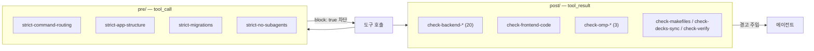
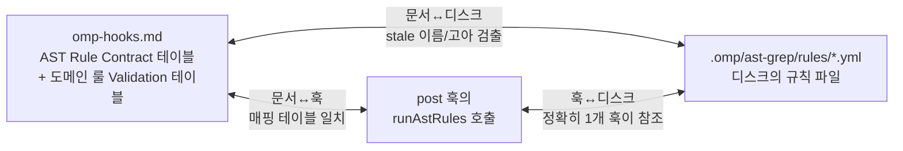
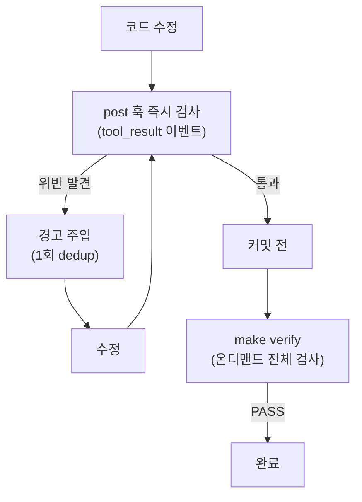
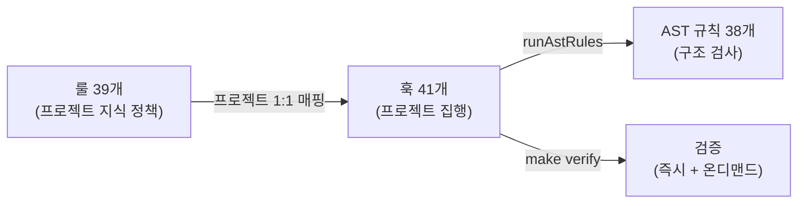

<!-- sync: backend-api-http.md=1d4ca22c74870840 -->
<!-- sync: backend-api-keys.md=240f10d0c15e7197 -->
<!-- sync: backend-app-forbidden-tokens.md=8b80f9d9fabee937 -->
<!-- sync: backend-app-setup.md=17d665e697444fd2 -->
<!-- sync: backend-audit-log.md=8ff51ab42272c7b2 -->
<!-- sync: backend-auth.md=94bcf2878675992d -->
<!-- sync: backend-background-tasks.md=f44f5777655cd583 -->
<!-- sync: backend-batch.md=65c45b90acb2340f -->
<!-- sync: backend-code-conventions.md=7f8ed81377c0e76a -->
<!-- sync: backend-core-config.md=dcd8e7bc6c1cbf9f -->
<!-- sync: backend-domain.md=6ba32e699fcc7876 -->
<!-- sync: backend-exceptions.md=d36379949336814d -->
<!-- sync: backend-file-upload.md=417dc0174bf98a36 -->
<!-- sync: backend-identity-tokens.md=6cb5ac851893ae08 -->
<!-- sync: backend-integration-configuration.md=b0ef98683632508c -->
<!-- sync: backend-integration.md=3fd57fcc535b4e66 -->
<!-- sync: backend-makefile.md=f25f9e888286eaa6 -->
<!-- sync: backend-middleware.md=f54d26f09ba562a2 -->
<!-- sync: backend-migrations.md=3b8dfbfbc558495b -->
<!-- sync: backend-naming.md=a9dc70a6e7e74b0c -->
<!-- sync: backend-ownership.md=17fc26d59cbcf0ca -->
<!-- sync: backend-rate-limit.md=5770db3d71475d11 -->
<!-- sync: backend-redis-cache.md=86ce5ccbbe5436f0 -->
<!-- sync: backend-router-params.md=acab7d3c10068fb3 -->
<!-- sync: backend-router-wiring-tokens.md=2c0e5f32af9a0587 -->
<!-- sync: backend-service-boundary-tokens.md=1a3a836df0cd5829 -->
<!-- sync: backend-sse.md=69de863a0eaf5e50 -->
<!-- sync: backend-table-design.md=4f4c1299879a5403 -->
<!-- sync: backend-testing.md=1b13201da3bbfe13 -->
<!-- sync: backend-transaction.md=4a614d04f599617d -->
<!-- sync: code-layout.md=8c1eaf01a499e622 -->
<!-- sync: decks-sync.md=e003ffe7cce93087 -->
<!-- sync: environment.md=b828a0f49ad196d2 -->
<!-- sync: frontend-code-conventions.md=b372444a2ca6c4e1 -->
<!-- sync: frontend-makefile.md=3c32695481893fee -->
<!-- sync: omp-ast-rules.md=c1c935f06f6ec5fe -->
<!-- sync: omp-conventions.md=fc872bbd4033e574 -->
<!-- sync: omp-hook-crash-guard.md=a738e96b64572770 -->
<!-- sync: omp-hooks.md=f11cbe77011f62eb -->
<!-- sync: omp-naming-consistency.md=23a6c62b84d1fc6d -->
<!-- sync: omp-skills.md=4a9d11a9c8538d89 -->
<!-- sync: root-git-workflow.md=d623ac8f064686ae -->
<!-- sync: root-makefile.md=eb585864798e1655 -->
<!-- sync: tooling.md=3f0fbcc88756686c -->
<!-- sync: strict-additive-writes.ts=b6b854ab47ba3576 -->
<!-- sync: strict-backend-app-structure.ts=c77cfecdda8db921 -->
<!-- sync: strict-backend-migrations.ts=701d0342f53006dd -->
<!-- sync: strict-command-routing.ts=1937b2e0fd04dee2 -->
<!-- sync: strict-no-subagents.ts=a60f42f59cd92d89 -->
<!-- sync: strict-no-vcs-publish.ts=d768e02e750c2fca -->
<!-- sync: strict-tooling.ts=0a81c93d6f73dab6 -->
<!-- sync: check-ast-rules.ts=4ff5ebb7e669cdcf -->
<!-- sync: check-backend-api-http.ts=7d815cf226e74ecc -->
<!-- sync: check-backend-api-keys.ts=de367c8e35e2a93f -->
<!-- sync: check-backend-app-setup.ts=f148f00a59aa765d -->
<!-- sync: check-backend-audit-log.ts=a7cd9c7806dc9ca4 -->
<!-- sync: check-backend-auth.ts=ee564bb32028f31d -->
<!-- sync: check-backend-background-tasks.ts=9f072eb78d6c9cb6 -->
<!-- sync: check-backend-batch.ts=b15f6b399d64392e -->
<!-- sync: check-backend-core-config.ts=356032ad613d6a96 -->
<!-- sync: check-backend-domain.ts=a20df1210c168b86 -->
<!-- sync: check-backend-exceptions.ts=4ec4128348117404 -->
<!-- sync: check-backend-file-upload.ts=521ff1840bf25dc0 -->
<!-- sync: check-backend-integration-configuration.ts=9f98d6294c9ca098 -->
<!-- sync: check-backend-integration.ts=e18cd13d79573aa6 -->
<!-- sync: check-backend-middleware.ts=6211305a529ebcc9 -->
<!-- sync: check-backend-migrations.ts=b43ada85e0680807 -->
<!-- sync: check-backend-naming.ts=6ac63ba3b8457d64 -->
<!-- sync: check-backend-ownership.ts=48fb2c0f86301d00 -->
<!-- sync: check-backend-rate-limit.ts=3cc784fd7c119665 -->
<!-- sync: check-backend-redis-cache.ts=0e8daba9e768e092 -->
<!-- sync: check-backend-router-params.ts=adb1d9fd2598a204 -->
<!-- sync: check-backend-sse.ts=ce52afc09d2a4f04 -->
<!-- sync: check-backend-table-design.ts=bfb89ad64e391d1d -->
<!-- sync: check-backend-tests.ts=ee649bd26d472f9c -->
<!-- sync: check-backend-transaction.ts=97019a3bb090d70e -->
<!-- sync: check-code-layout.ts=1110e6c734757dd6 -->
<!-- sync: check-decks-sync.ts=d1060909b737414c -->
<!-- sync: check-environment.ts=008228e5b3559397 -->
<!-- sync: check-frontend-code.ts=6ee23f31ed996c85 -->
<!-- sync: check-makefiles.ts=a232a657107e6577 -->
<!-- sync: check-omp-hooks.ts=959d6e2fdb461e17 -->
<!-- sync: check-omp-rules.ts=ae4dab8106a0dfd3 -->
<!-- sync: check-omp-skills.ts=67831f31a4b0b420 -->
<!-- sync: check-omp-types.ts=8171ad53424a7feb -->
<!-- sync: check-tooling.ts=10b444f2217c3588 -->
<!-- sync: check-verify.ts=5a28d5df52b21485 -->
<!-- sync: lib/ast-rules.ts=7d8313da1927a4d5 -->
<!-- sync: lib/backend-api-flow.ts=6a4e5db31d94f1c3 -->
<!-- sync: lib/backend-api-http.ts=f457d2ee281758db -->
<!-- sync: lib/backend-auth.ts=a5bca744745861b0 -->
<!-- sync: lib/backend-domain-layers.ts=2ff2f5555721a967 -->
<!-- sync: lib/backend-domain-structure.ts=b5bfd745c7280afc -->
<!-- sync: lib/backend-exceptions.ts=8be50968435c4e3c -->
<!-- sync: lib/backend-external-api-probe.ts=725e9b18ba527e80 -->
<!-- sync: lib/backend-integration-configuration.ts=29fca1d61fc7cc03 -->
<!-- sync: lib/backend-migration-policy.ts=1ac42fc16bd787b3 -->
<!-- sync: lib/backend-naming.ts=3fd876d8e4221309 -->
<!-- sync: lib/backend-orm-sync.ts=43d591cd8eb0e234 -->
<!-- sync: lib/frontend-source.ts=5fe662fafd8aab3e -->
<!-- sync: lib/harness-env.d.ts=c41ee1561d50960b -->
<!-- sync: lib/hook-domain-literals.ts=5853758bdcc845ad -->
<!-- sync: lib/hook-dormancy.ts=764526765b1aba69 -->
<!-- sync: lib/hook-metrics.ts=0e383f687f1c56da -->
<!-- sync: lib/hook-rule-hint.ts=b642274590acf88c -->
<!-- sync: lib/hook-safety-guard.ts=6d23050389a76a12 -->
<!-- sync: lib/hook-scope.ts=21a1b6fab8c467bd -->
<!-- sync: lib/hook-tool-paths.ts=0bec0929966aab07 -->
<!-- sync: lib/hook-visibility.ts=378b831827345c84 -->
<!-- sync: ast-grep/rules/audit/=fa43ff9131409a46 -->
<!-- sync: ast-grep/rules/audit-readonly/=4371bf3c9670540a -->
<!-- sync: ast-grep/rules/auth/=ef53c5cd221f6c11 -->
<!-- sync: ast-grep/rules/background/=2631432e24043280 -->
<!-- sync: ast-grep/rules/batch/=d8b3cf5bda13247d -->
<!-- sync: ast-grep/rules/cache/=0c4f126bc1ea5cd5 -->
<!-- sync: ast-grep/rules/conventions/=f9af2070ed6ab3d6 -->
<!-- sync: ast-grep/rules/domain/=9deae1c972838f6c -->
<!-- sync: ast-grep/rules/env-security/=b3302595d17d11db -->
<!-- sync: ast-grep/rules/environment/=d6f02a1f06b0032a -->
<!-- sync: ast-grep/rules/exceptions/=16910346cf860f6d -->
<!-- sync: ast-grep/rules/factory/=f12bdc8bde61c55a -->
<!-- sync: ast-grep/rules/integration/=90b1990249a39920 -->
<!-- sync: ast-grep/rules/layering/=0cd53dee4be2a527 -->
<!-- sync: ast-grep/rules/logging/=e8a48abc7061fc3c -->
<!-- sync: ast-grep/rules/model/=d95cd8eeec07de9d -->
<!-- sync: ast-grep/rules/naming/=20d21ed70309940d -->
<!-- sync: ast-grep/rules/offload/=4bb3cc65a9370b86 -->
<!-- sync: ast-grep/rules/ownership/=9723397c4a35ebf5 -->
<!-- sync: ast-grep/rules/ownership-router/=cf764d3af48ee904 -->
<!-- sync: ast-grep/rules/router/=945a6f4bd5297fe5 -->
<!-- sync: ast-grep/rules/service/=45cc71c05ceb3001 -->
<!-- sync: ast-grep/rules/sse/=22cb7d807c4ea3fb -->
<!-- sync: ast-grep/rules/transaction/=c613686939e1ac96 -->
<!-- sync: ast-grep/rules/upload/=db8cc2d3547eabc2 -->
<!-- sync: extensions/continuity/=d9b42195ac7c4743 -->

# 하네스 룰 & 훅 아키텍처

룰(지식)과 훅(집행)의 연관 관계 — 빠짐 없는 매핑

<div class="muted center">FastAPI Standard — OMP Harness</div>

---

# 역할 분담: 룰 = 지식, 훅 = 집행

```mermaid
flowchart LR
    subgraph 지식["룰 (지식)"]
        R[".omp/rules/*.md<br/>39개 규칙 문서"]
        A[".omp/ast-grep/rules/*.yml<br/>31개 AST 규칙"]
    end
    subgraph 집행["훅 (집행)"]
        PRE[".omp/hooks/pre/<br/>7개 strict-* 차단"]
        POST[".omp/hooks/post/<br/>35개 check-* 검사"]
        L[".omp/hooks/lib/*.ts<br/>공유 정책·검사 도우미"]
    R -->|"프로젝트 1:1 거버넌스<br/>check-omp-hooks 검증"| POST
    A -->|"runAstRules 실행"| POST
    PRE -.->|"tool_call 차단"| R
    POST -.->|"tool_result 검사"| R
```

<div class="muted center">**프로젝트 1:1 분리 원칙** — OMP runtime 요구사항이 아닌 repository governance</div>

---

# 룰 로딩 메커니즘 (3 버킷)

| 버킷 | 트리거 | 로딩 방식 |
|---|---|---|
| **Rulebook** | `description` 존재, always-apply 아님 | name + globs + description만 시스템 프롬프트에 노출, 내용은 `rule://<name>`으로 온디맨드 |
| **Always-apply** | `alwaysApply: true` | 전체 내용 매 세션 주입 — **최대 2개** 유지 |
| **TTSR** | `condition`(정규식) + `scope` + `interruptMode` | 매칭 순간 **본문 전체 주입** — `interruptMode: always`면 편집이 디스크에 닿기 전에 중단 |

<div class="muted small">**TTSR globs 함정** — TTSR 룰의 globs는 런타임 경로 게이트. bash 호출은 파일 경로를 안 가지므로 globs 있는 TTSR 룰은 `make migrate`에 절대 트리거 안 됨 → bash 트리거 룰은 globs 생략</div>

- `RULES.md` (`.omp/` 최상위) = sticky always-apply — `rules/`에 중복 금지
- 룰 추가 = `.omp/rules/<scope>-<name>.md` 생성만 — AGENTS.md에 `@rules/` import 금지
- **globs는 아무것도 전달하지 않는다** (실증) — glob 매칭 파일을 편집해도 본문 주입 0. rulebook 항목은 "훅이 기계적으로 집행하는 것의 설명서"이고, 집행은 항상 훅(`make verify`)

---

# TTSR 트리거 룰 — 위반 순간 전달

| 룰 | condition (구성물, 단어 아님) | scope | 매핑 훅 |
|---|---|---|---|
| `backend-app-forbidden-tokens.md` | `HTTPException\(` · `import HTTPException` · `os.environ[` · `os.getenv(` | `tool:edit/write(backend/app/**/*.py)` | `check-backend-exceptions` + `check-environment` |
| `backend-service-boundary-tokens.md` | `async with [\w.]*session.begin\(` · `return StreamingResponse\(` · `asyncio.create_task\(` · `\bhttpx2\b` | routers / repositories / batch | `check-backend-transaction` + `-sse` + `-background-tasks` + `-integration` |
| `backend-router-wiring-tokens.md` | 인라인 `Depends(`·`Query(`·`Path(`·`Body(`·`Header(` | `tool:edit/write(backend/app/routers/*.py)` | `check-backend-auth` |
| `backend-identity-tokens.md` | `current_user: CurrentUserDep` | services / repositories / batch | `check-backend-auth` |
| `omp-hook-crash-guard.md` | 래핑 안 된 `pi.on("tool_result", (…) => {` | `tool:edit/write(.omp/hooks/post/*.ts)` | `check-omp-hooks` |
| `backend-migrations.md` | `alembic` · `migrat` · `downgrade` · `revision` (워크플로 트리거) | `tool:bash` | `strict-backend-migrations` + `check-backend-migrations` |

- **단어가 아니라 구성물을 매칭** — `# No session.begin() here` 같은 "금지를 설명하는 주석"에 발화하면 중단시키는 룰로서 최악. `omp ttsr scan`으로 현재 트리에서 매치 0 확인
- **일관성은 훅이 강제** — `check-omp-rules`가 트리거 6개 계약을 검사: `condition`은 문자열 + 정규식 컴파일, `scope`·`interruptMode` 명시, condition의 모든 식별자(≥4자)가 본문에 문서화, `## Enforcement` 절이 소유 훅을 명시, **scope가 고르는 파일들에 대해 매치 0**(합법 코드 재작성이 턴을 중단시키지 않음)
- **astCondition은 사용 금지** — 매칭은 로그에 찍히지만 모델에 전달되지 않고, `repeatMode: once`가 이후를 억제(실증)
- **스트림 선택은 측정으로** — `backend-migrations`는 원래 `scope: "text, tool"`이었고 87세션 17회 발화 전량이 오탐(`alembic/ # DB migrations` 같은 서술 산문, 생성된 리비전 파일 편집)이었다. 워크플로가 실제로 실행되는 스트림은 명령뿐이므로 `tool:bash` 하나로 축소 — 산문·편집 발화 0, `make migrate`·`alembic revision` 발화 유지(`omp ttsr test`로 증명)

---

# 훅 실행 메커니즘



- **pre** — `tool_call` 리슨, denylist 패턴 매칭, `return { block: true }`로 차단
- **post** — `tool_result` 리슨, 공용 `wrapWarning()`으로 원본 결과를 보존한 notice만 추가
- **컨텍스트 절약** — 모든 post-hook은 `buildSafeWarning()` 사용: 이슈 3개 제한, 긴 결과는 1줄 notice, 동일 hook/tool 경고는 최대 2회
- **크래시 가시성** — 런타임은 `tool_result` 핸들러의 예외를 삼키고 계속 진행한다: 훅은 조용히 죽고 `make` 타겟만 초록색으로 남는다. 그래서 모든 post-hook 본문은 `guarded("<hook>", event, () => { ... })`(`lib/hook-visibility.ts`) 안에서 실행되고, 예외는 `<system-notice>`(hook당 2회 제한) + `.omp/state/hook-crash.log`(무제한) + stderr로 보고된다 — 재throw는 없다
- **자기 측정** — `guarded()`가 모든 post hook 실행을 유일하게 관측하므로 그 자리에서 소요 시간·결과(`quiet`/`warned`/`crashed`)를 `lib/hook-metrics.ts`로 기록(`.omp/state/hook-metrics.jsonl`, 15초 간격 스냅샷). `make hook-report` → 훅별 runs/worked/warned/**fixed**/crash/totalMs/maxMs + "일한 실행당 ms". 실측 43.1ms/working run
- **경고→수정율** — `warned` 카운트만으로는 "그 경고가 먹혔는가"를 답할 수 없다. 발견은 **도구 인자가 지목한 파일로 키잉**해 열리고, post hook은 트리 전체를 스캔하므로 다시 `quiet`가 되면 사실상 해소된 것이다. 문제는 귀속: 실측 698건의 경고 직후 행동은 명령 50%(대개 경고가 지시한 `make check-*`), 다른 파일 쓰기 38%, **같은 파일 쓰기 10%**였다. 그래서 이 호출이 그 파일을 지목했으면 `fixed`, 아니면 `cleared`로 닫는다 — 앞의 것만 세면 영구 0을 보고하게 된다. `read` 후의 침묵은 트리에 대해 아무것도 증명하지 않으므로 무엇도 닫지 않는다
- **룰 채널 계측** — 룰북 본문은 `rule://<name>`과 `.omp/rules/<name>.md` 두 문으로 도달한다. 실측: 87세션 661회 읽기 중 `rule://`는 74회(11%)뿐이고 443회는 **저작**(같은 세션에서 그 룰을 편집)이었다. 한쪽 문만 세면 쓰이는 채널이 죽은 것으로 읽히고, 저작을 안내로 세면 죽은 채널이 쓰이는 것으로 읽힌다 → `check-omp-rules`(소유 훅) 한 곳에서만 기록해 36배 중복을 피하고, guidance/authoring/paged/`rule://`를 분리 보고
- **경고 형식** — `<파일>[:<줄>]: <무엇이 틀렸나> — <어떻게 고치나>`. 파일을 이름 대지 않는 리터럴 경고는 `check-omp-hooks`가 거부(grep으로 찾게 만드는 경고는 컨텍스트만 먹는다)

---

# 프로젝트 거버넌스: 룰 ↔ 훅 매핑 (전체 39개)
| 룰 (`.omp/rules/`) | Pre 훅 | Post 훅 |
|---|---|---|
| `backend-domain.md` | `strict-backend-app-structure` | `check-backend-domain` |
| `backend-auth.md` | — | `check-backend-auth` |
| `backend-exceptions.md` | — | `check-backend-exceptions` |
| `backend-api-http.md` | — | `check-backend-api-http` |
| `backend-router-params.md` | — | `check-backend-router-params` |
| `backend-naming.md` | — | `check-backend-naming` |
| `backend-transaction.md` | — | `check-backend-transaction` |
| `backend-migrations.md` | `strict-backend-migrations` | `check-backend-migrations` |
| `backend-table-design.md` | — | `check-backend-table-design` |
| `backend-batch.md` | — | `check-backend-batch` |
| `backend-testing.md` | — | `check-backend-tests` |
| `backend-middleware.md` | — | `check-backend-middleware` |
| `backend-app-setup.md` | — | `check-backend-app-setup` |
| `backend-core-config.md` | — | `check-backend-core-config` |
| `backend-rate-limit.md` | — | `check-backend-rate-limit` |
| `backend-background-tasks.md` | — | `check-backend-background-tasks` |
| `backend-ownership.md` | — | `check-backend-ownership` |
| `backend-audit-log.md` | — | `check-backend-audit-log` |
| `backend-redis-cache.md` | — | `check-backend-redis-cache` |
| `backend-file-upload.md` | — | `check-backend-file-upload` |
| `backend-sse.md` | — | `check-backend-sse` |
| `backend-api-keys.md` | — | `check-backend-api-keys` |
| `backend-integration.md` | — | `check-backend-integration` |
| `backend-integration-configuration.md` | — | `check-backend-integration-configuration` |
| `environment.md` | — | `check-environment` |
| `backend-code-conventions.md` | — | `check-verify` (toolchain) |
| `backend-makefile.md` | `strict-command-routing` | `check-makefiles` |
| `root-makefile.md` | `strict-command-routing` | `check-makefiles` |
| `backend-router-wiring-tokens.md` (TTSR) | — | `check-backend-auth` |
| `backend-identity-tokens.md` (TTSR) | — | `check-backend-auth` |
| `frontend-makefile.md` | `strict-command-routing` | `check-makefiles` |
| `frontend-code-conventions.md` | — | `check-frontend-code` |
| `code-layout.md` | — | `check-code-layout` |
| `tooling.md` | `strict-tooling` | `check-tooling` |
| `omp-conventions.md` | — | `check-omp-rules` |
| `omp-naming-consistency.md` | — | `check-omp-rules` + `check-omp-hooks` |
| `omp-ast-rules.md` | — | `check-ast-rules` + `check-omp-hooks` |
| `omp-hooks.md` | — | `check-omp-hooks` |
| `omp-skills.md` | — | `check-omp-skills` |
| `decks-sync.md` | — | `check-decks-sync` |
| `RULES.md` (sticky) | `strict-no-subagents` | — |
| `RULES.md` (sticky) | `strict-no-vcs-publish` | — |

<div class="muted small">**계약** — 모든 룰은 ≥1 훅, 모든 훅은 ≥1 룰. 고아는 위반 (check-omp-hooks가 기계 검증)</div>

---

# Pre 훅 6개 — 실행 전 차단
| 훅 | 스코프 | 차단 내용 |
|---|---|---|
| `strict-command-routing.ts` | **cross-cutting** | 직접 도구 호출 차단 (make/bash/docker) — `make <target>` 사용 강제 |
| `strict-backend-app-structure.ts` | backend | 문서화된 backend/ 구조 밖 write 차단 (app/ 신규 디렉토리, app 루트 스트레이 파일, 비표준 backend/ 위치) |
| `strict-backend-migrations.ts` | backend | upstream에 존재하는 마이그레이션 파일 수정 차단 + 리비전 파일 손수 생성 차단 (`make migrate-gen`으로 번호 자동 증가) — `backend-migrations` TTSR은 `tool:bash`만 보므로 직접 write는 여기서 잡는다 |
| `strict-no-subagents.ts` | **cross-cutting** | `task` 도구로 서브에이전트 생성 차단 (agent 타입 6종) |
| `strict-no-vcs-publish.ts` | **cross-cutting** | `git commit`/`git push` 자체를 차단 — VCS 는 사용자 소관(RULES.md Session Safety). 이 피험자 트리는 바깥 레포가 추적하므로 피험자의 커밋/푸시는 바깥 레포를 건드린다 | 벤치 셀(`BENCH_CELL=1`)에서는 `git checkout/restore/stash/revert/reset` 도 차단한다 — 지워진 참조 구현을 VCS 에서 되살리는 것은 구현이 아니다(2026-08-29 실측: 그렇게 1248초·writes 2·산출물 0/6 으로 '초록' 이 나왔다). 인터랙티브에서는 허용 |
| `lib/hook-scope.ts` | **cross-cutting** | 훅의 경로 게이트 — `touchesPath`(경로 있는 이벤트만) / `touchesStrict`(셸 명령까지). 실측 2026-08-29: 변이 도구 결과 1회에 post 훅 36개가 write 6.8초·bash 4.9초를 썼고 그중 3.3초가 무관한 메타 검사였다. 게이트 후 bash 1.56초 |
| `strict-tooling.ts` | **cross-cutting** | 파이썬/셸 스크립트 및 루트 `scripts|tools|bin|utils/` 생성 차단 — 스크립트성 코드는 `.omp/hooks/` TypeScript |

<div class="muted small">denylist 패턴 — 명령 경계에 앵커 (줄 시작, `&&`/`||`/`;`/`|`/`(` 뒤, sudo 옵션), 상대경로 프리픽스 허용, 인자 단어는 매칭 안 됨</div>

---

# Post 훅 35개 — 실행 후 검사

## Backend (24)

| 훅 | 검사 내용 |
|---|---|
| `check-backend-domain` | 5-layer CRUD 패턴, 모델/스키마/레포/서비스/라우터, DI, alembic check |
| `check-backend-auth` | JWT 인증, 도메인 예외, router/service AST 규칙 |
| `check-backend-exceptions` | 코어 예외 정책 — 빌트인/HTTPException/인스턴스 raise 금지, 클래스↔핸들러 양방향, 응답 바디(detail/code/request_id) |
| `check-backend-api-http` | router ↔ `api/*.http` 양방향 동기화, 상태 중립성, 행위자 계약(auth.http만 계정 생성·삭제, 나머지는 시드 계정 로그인 — 마이그레이션 57) — 런타임 증명은 `make check-api-flow` |
| `check-backend-router-params` | 라우터 파라미터 4종(path/body/dep/query), 경로 템플릿↔시그니처, UUID id, 페이지네이션 별칭·상한 |
| `check-backend-naming` | 파일명, 변수명, 캡슐화, 모듈 프라이빗 |
| `check-backend-transaction` | `session.begin()` 배치 규칙 |
| `check-backend-migrations` | ORM ↔ DB 동기화 (alembic check) |
| `check-backend-table-design` | 테이블 설계 불변식 — 원자성(1NF), PK/FK 계약, 닫힌 값 집합 CHECK |
| `check-backend-batch` | 배치 잡 컨벤션 (engine 직접, Service(session)) |
| `check-backend-tests` | 테스트 표준 (도메인별, 10케이스, auth, conftest) |
| `check-backend-middleware` | CORS, CSRF Origin/Fetch-Metadata 검증, 보안 헤더, Request ID, structlog |
| `check-backend-app-setup` | health check, OpenAPI 메타데이터, /api/v1 |
| `check-backend-core-config` | settings validator, DB pool, error schema |
| `check-backend-rate-limit` | slowapi limiter (login/signup) |
| `check-backend-background-tasks` | BackgroundTasks 패턴 |
| `check-backend-ownership` | created_by 소유권 검증 |
| `check-backend-audit-log` | 읽기 전용 audit 엔드포인트 |
| `check-backend-redis-cache` | TTL + invalidation |
| `check-backend-file-upload` | UploadFile size/content-type 가드 |
| `check-backend-sse` | EventSourceResponse |
| `check-backend-api-keys` | X-API-Key 의존성 |
| `check-backend-integration` | `IntegrationClient`, httpx2 timeout/retry/error-mapping 계약 |
| `check-backend-integration-configuration` | DB-managed provider/operation/request/response configuration contract + **operation별 계약 픽스처** — `tests/core/fixtures/integration/<code>.json`(측정한 교환 1건)을 요구하고, 시드 행을 다시 적은 픽스처와 손으로 쓴 `test_execute_renders_<op>_contract`를 거부 |

<div class="muted small">**계약 픽스처로 바꾼 이유 (실측)** — operation 하나당 손으로 쓴 계약 테스트가 148~191줄이었고, 그 줄들은 시드에 이미 있는 필드 목록을 다시 적은 것이었습니다. 복사본은 자기 자신과는 일치하면서 데이터베이스와는 어긋날 수 있습니다 — 실제로 그랬습니다: 한 테스트는 시드가 이미 **CALLER 필수**로 만든 `page_no`를 LITERAL 1로 검증하고 있었고, 세 테스트는 시드가 17·18·19개 키를 매핑하는데 **2개**만 검증했습니다. 이제 파라미터화 테스트 1개가 리플레이된 시드로 클라이언트를 만들고, 픽스처(59~80줄 JSON)에는 측정한 것만 둡니다 — 보낸 입력, 받은 응답, 나갔어야 할 경로·payload·metadata. 거절도 계약이라 `expect.raises`로 기록합니다(역순 창 → ERROR-334, 24줄). 손으로 쓴 467줄이 삭제됐고 커버리지는 100% 그대로입니다.</div>

## Frontend / OMP / Root
| 훅 | 검사 내용 |
|---|---|
| `check-frontend-code` | React 19 함수형, `@/` alias, fetch + res.ok, 하드코딩 포트 금지 |
| `check-code-layout` | 모든 코드의 배치 — 주석(죽은 코드/작업 마커 금지), 섹션 배너, 상수 위치(`let` 금지), 클래스 멤버 순서 (Python·TS 공통) |
| `check-tooling` | 스크립트 언어 정책 — 파이썬은 `backend/app|tests|alembic` 전용, 셸은 `start.sh` 하나, `.omp/hooks/`는 TS만, 모든 `check-*` 타겟은 `node .omp/hooks/...` |
| `check-omp-rules` | 동적 로딩 계약 — `@rules/` import 금지, frontmatter 유효, always-apply ≤ 2 |
| `check-ast-rules` | 룰별 실증 — 모든 ast-grep 룰이 위반 케이스에서 발화하고 준수 케이스에서 침묵하는지 (`ast-grep test`), ast-grep 부재는 실패 |
| `check-omp-hooks` | 훅↔문서 동기화, 룰↔훅 매핑, post 훅 계약 (content 추가, MUTATING_TOOLS, `buildSafeWarning` 호출 형태, `guarded()` 크래시 래퍼) |
| `check-omp-skills` | skills catalog ↔ `.omp/skills/*/SKILL.md` 양방향 동기화, frontmatter/trigger/verification/lifecycle 검사 — lifecycle은 project metadata |
| `check-makefiles` | Makefile 타겟 ↔ 규칙 문서 테이블 일치 (backend/frontend/root) |
| `check-decks-sync` | 덱이 모든 룰/훅/AST 디렉토리를 언급하는지 (하네스 ↔ 덱 싱크) |
| `check-verify` | backend + frontend verify 실행 (lint, typecheck, test/build) |

---

# AST 규칙 계약 — 24개 디렉토리 ↔ 실행 훅

| AST 규칙 디렉토리 | 규칙 수 | 실행 훅 | 규칙 (38개) |
|---|---|---|---|
| `domain/` | 3 | `check-backend-transaction` | service-method-async, repository-method-uuid-param, service-transaction-write-only |
| `router/` | 4 | `check-backend-auth` | write-auth, inline-depends(Depends/Query/Path/Body/Header), response-model, auth-all |
| `model/` | 2 | `check-backend-domain` | id-standard, field-mapped-pattern |
| `service/` | 1 | `check-backend-auth` | repository-param |
| `naming/` | 2 | `check-backend-naming` | var-name, repository-access |
| `transaction/` | 1 | `check-backend-transaction` | service-only |
| `conventions/` | 2 | `check-backend-auth` | inner-function-underscore, current-user-router-only |
| `batch/` | 3 | `check-backend-batch` | job-async, service-constructor, session-from-engine |
| `environment/` | 3 | `check-environment` | os-environ-direct, hardcoded-connection, hardcoded-port |
| `sse/` | 1 | `check-backend-sse` | streaming-response |
| `background/` | 1 | `check-backend-background-tasks` | create-task |
| `upload/` | 1 | `check-backend-file-upload` | no-size-guard |
| `ownership/` | 1 | `check-backend-ownership` | check-missing |
| `audit/` | 1 | `check-backend-audit-log` | exposes-secret |
| `integration/` | 1 | `check-backend-integration` | timeout-configured |
| `exceptions/` | 3 | `check-backend-exceptions` | builtin-forbidden, http-exception-forbidden, instance-raise |
| `cache/` | 1 | `check-backend-redis-cache` | no-ttl |
| `layering/` | 1 | `check-backend-domain` | repository-import (라우터가 레포지토리를 import) |
| `factory/` | 1 | `check-backend-domain` | from-session (DI 밖에서 서비스 조립) |
| `auth/` | 1 | `check-backend-auth` | system-actor (인증된 호출자인데 `created_by="system"`) |
| `ownership-router/` | 1 | `check-backend-ownership` | router-check (소유권 비교가 라우터에) |
| `audit-readonly/` | 1 | `check-backend-audit-log` | write-endpoint (감사 API에 쓰기 엔드포인트) |
| `logging/` | 1 | `check-backend-middleware` | secret-in-log (자격증명 로깅) |
| `env-security/` | 1 | `check-environment` | env-branch (보안·마이그레이션이 `settings.env`로 분기) |
| `offload/` | 1 | `check-backend-auth` | password-hash (argon2 25ms를 이벤트 루프에서 실행) |

<div class="muted small">**의미론** — 매치는 위반 (기본, negative). `expect: present` 선언 시 매치 부재가 위반 (positive). ast-grep 불가 시 `runAstRules`는 `[]` 반환 — 문자열 검사로 우아한 폴백</div>

---

# 3-Way Sync — 문서 ↔ 디스크 ↔ 훅



- **문서↔디스크** — 문서에 있는 파일이 디스크에 존재 (stale 금지), 디스크 파일이 문서에 등재 (고아 금지)
- **훅↔디스크** — 규칙 디렉토리는 정확히 1개 훅이 참조, runAstRules 사용자는 ≥1 디렉토리 참조
- **네이밍** — `<subject>-<property>.yml`, 스코프 프리픽스/약어 금지
- 규칙 변경 시: YAML 수정 → 문서 2곳 갱신 → `make verify`

---

# 검증 워크플로우



- **즉시 검사** — 편집 직후 post 훅이 위반을 터미널 + 컨텍스트에 노출
- **온디맨드** — `make verify` / `make check-<name>`이 동일 검사를 CLI로 실행 (pre-commit 신호)
- `check-verify` = backend(lint/typecheck/test) + frontend(lint/typecheck/build)

---

# 이번 라운드에 채운 구멍 — 문서만 있던 규격에 집행을 붙였다

| 규격 | 이전 상태 | 지금 |
|---|---|---|
| 테스트 docstring | 모듈 50% / 함수 19% | ruff `D`가 존재 강제(147건 작성), `check-backend-tests`가 **이름 되풀이 금지** |
| 마이그레이션 레이아웃 | 57개가 관례로만 동일 | docstring·필드 순서·`upgrade`/`downgrade` 쌍·**조용한 no-op downgrade 금지**·상수 위치 (푸시 전 리비전만 — 푸시된 것은 불변) |
| 공백 위생 | `api/*.http`만 | 모든 텍스트 자산: 후행 공백·탭·CRLF·파일 끝 개행 1개 (`ruff W`가 파이썬 라인 내부, 훅이 파일 경계) |
| Makefile 도움말 | 13/13 우연히 충족 | 모든 타겟에 `## <설명>` 필수 (root/backend/frontend/decks) |
| **마이그레이션 게이트** | DB 미도달 시 `PASS: ORM/DB in sync` — **실제 드리프트를 숨김**(측정) | 비교하지 못한 이유를 dormant로 명시 |
| **Host 허용목록** | 룰이 `TrustedHostMiddleware`를 요구했으나 코드에 없고 검사도 없음 | 미들웨어 추가 + `ALLOWED_HOSTS` 필수 설정 + 훅 검사 |
| **argon2 25ms** | 이벤트 루프에서 해싱 (측정) | `to_thread.run_sync` + AST 룰 `offload/password-hash` |
| **관계 로딩** | eager-load는 관례일 뿐, 누락 시 프로덕션에서 `MissingGreenlet` | 전 관계 `lazy="raise_on_sql"` + 선언 검사 |
| **JWT 클레임 / 스케줄러 / 풀 상한 / redis 헬스체크** | 문서·검사 없음 | `iat`+`require`, `id/replace/max_instances/coalesce/misfire`, `httpx2.Limits`, `health_check_interval` |
| 임포트 정렬 | `# isort: off`/`# isort: on` 래퍼를 **요구**했고 근거("isort가 배너를 흡수한다")는 측정 결과 거짓 | 지시자 33개 제거, 정렬은 ruff `I` + `lines-after-imports = 2`가 소유, **국소 회피 금지**(`# isort:`, `# noqa: I001`) |
| 배너 정렬·대응 | 폭 87/87 우연 일치, 섹션 누락 무탐지 | 폭 62자(`# ` + `=`×60) 고정 + 위/아래 일치, **구성물이 섹션을 지명**(`router = APIRouter(` → `Router` 배너, `class` → `Classes`/`Middleware`) |
| AST 룰 근거 | 7/31만 주석 | `rule:` 위 `#` 주석 필수 — 패턴은 *무엇*만 말하고 *왜*는 못 말한다 |
| 계층 건너뛰기 / `from_session` | 문서만 | `layering/`, `factory/` AST 룰 |
| `/api/v1` 마운트 | main.py에 문자열 존재만 | 라우터 모듈 ↔ 마운트 대조 (health만 비버전) |
| 비멱등 재시도 | 코드가 지킬 뿐 | 모든 `_backoff` 호출이 `operation.idempotent` 가드 아래 |
| 자격증명 로깅 / audit 쓰기 / 라우터 소유권 검사 / 보안 `settings.env` | 문서만 | `logging/`, `audit-readonly/`, `ownership-router/`, `env-security/` |
| post 훅 차단 금지 | 문서만 | `check-omp-hooks`가 `return { block: true }` 검출 |

<div class="muted small">**룰 오류 1건 수정** — `backend-auth.md`는 `created_by="system"`을 전면 금지했지만 공개 signup에는 호출자가 없어 그 코드가 정답이었다. 훅이 없어서 모순이 드러나지 않았고, 이제 룰은 "인증된 호출자가 있을 때만 금지"로 좁혀져 구조적으로 집행된다.</div>

---

# 작업 지속성 확장 — `.omp/extensions/continuity/`

훅이 아니라 **확장**입니다: 세션 수명 이벤트·세션 상태·압축에 개입해야 하고, `-e` 없이 `.omp/extensions/`에서 **자동 로드**됩니다(별도 프로세스 pid로 실증).

| 문제 | 기존 | continuity |
|---|---|---|
| 자동 압축이 실패하면 세션이 줄지도, 계속하지도 못함 | `Auto-compaction failed: …` 후 그대로 | `auto_compaction_end`에서 실패 감지 → `ctx.compact()` 재시도 → `session_before_compact`가 **모델 없는 결정론적 요약**으로 응답 |
| 압축이 골을 요약해 없앰 | 요약 모델의 판단에 의존 | `session.compacting`이 골 카드를 요약기 컨텍스트로 넣고 `preserveData`에 상태를 실음 + **압축 후 카드를 메시지로 재게시** (실측: 저장된 요약문은 카드를 인용하지 않았고, `appendEntry` 상태는 모델에게 전달되지 않음 — 재게시가 유일한 원문 경로) |
| 툴콜/띵킹 무한 루프 | 사람이 끊어야 함 | repeat/oscillation/errorLoop/stall/thrash 5종 감지 → nudge → 골 카드 재주입 → 압축 (진전 시 사다리 리셋) |
| **측정만 하고 산출물을 안 만듦** | 어떤 반복 감지기도 못 봄 (매 호출이 새롭고 매 턴이 배움) | `blind`: 무장된 수용 술어의 `file`/`grep`이 미달인데 **6턴 동안 쓰기 0회**면 그 경로를 이름으로 지목해 스티어. 실측 — 로컬 35B가 20분·27턴·도구 66회에 **쓰기 0회**; 도입 후 원장 `blind` 2/2 `broke` (발화 시점 count 12, 1턴 만에 해소) |
| 검사 없이 같은 파일 반복 수정 | 없음 | `thrash`: 한 파일에 3회 수정 + 그 사이 검사 0 -> 스티어. `write`/`edit`(해시라인 본문의 경로)/`ast_edit`뿐 아니라 **`eval` 안의 `writeFileSync`도 편집으로 계산** (실측: 이 세션의 하네스 편집은 전부 그 경로였음) |
| 로컬 모델 임계가 거짓 분모에 걸림 | 없음 | **사용량 기반 선제 압축을 제거**. 실측: 툴 중심 런에서 24/24턴이 mid-loop로 유보되고, 35,749토큰 요청은 런타임이 거부(`Nothing to compact`). 런타임 자신이 75%/78%에서 처리하므로 프로필은 보고 전용, 압축은 루프 3단(경계에서만)과 실패 복구만 |
| 세션 상태 불명 | 없음 | 세션 엔트리 + `preserveData` + `.omp/state/` 3중 영속, `setStatus`로 `loop/esc/cmp` 노출 |
| 확장이 죽으면 조용함 | 런너가 throw를 삼킴 | 모든 핸들러를 가드로 감싸 `notify`로 승급 |
| "완료"가 반증 불가 | 에이전트가 끝났다고 하면 끝 | **선언이 필요 없습니다.** 골은 사용자 요청 원문(`message_start`, `role: "user"`)이고, 완료 판정은 저장소 게이트입니다 — 워크트리가 더러운 세션이 멈추려 하면 `session_stop`에서 `make verify`를 돌려 red면 실패 줄을 인용해 `{ continue: true }` (상한 3회, 60초 디바운스, `stop_hook_active` 재귀 가드) |
| 무인·무의도 실행이 골을 잃음 | 모델이 툴을 불러야 발동 | 요청을 그대로 골로 적어 상태에 영속 → 압축·재개를 넘어 살아남음 (실측: 로컬 35B는 어떤 실행에서도 `continuity_goal`을 부르지 않음) |
| 진행 중 턴에서 압축해 요청이 취소됨 | `messages` 마지막 항목만 검사 | 마지막 항목은 **도구 결과**이므로 mid-loop을 안전 경계로 오판 → 턴 자신의 `stopReason: "toolUse"` 우선, 없으면 도구 결과를 건너뛰며 역방향 탐색 (실측: 로컬 35B가 매번 41초에 `Request was aborted`, 수정 후 25턴·도구 66회·자동 압축 1회 통과) |
| 세션을 다시 열면 처음부터 | 브리핑을 다시 타이핑 | 도착 시 골 카드 + "커밋되지 않은 변경이 남아 있다"를 스스로 게시 (`git status`만 읽으므로 밀리초; 게이트는 정착 시점에만) |
| 작은 모델은 임계 전에 무너짐 | OMP 임계까지 대기 | 컨텍스트 창 < 200k면 **55%에서 선제 압축** (압축 세대당 1회, `/model` 전환에 자동 추종) |

| 임계값이 근거 없는 상수 | 주석에만 이유 | 임계는 그 값이 잡은 실패를 주석에 적고, 경계는 합성 프루프가 고정한다 — 값이 바뀌면 프루프가 먼저 깨진다 |

<div class="muted small">**원장 판독** — break-rate가 낮으면 그 신호가 루프가 아니거나 개입이 틀린 것이고, 항상 높은데 발화 count가 크면 더 일찍 잡을 수 있다는 뜻입니다. 진전이 없는데 같은 시그니처가 다시 오거나 3턴이 지나면 `failed`로 닫히므로, 성공만 기록되는 원장이 되지 않습니다.</div>

<div class="muted small">**코호트로 읽는다** — 풀링된 break-rate는 "이 디텍터가 지금 어떻게 동작하는가"에 답하지 못합니다. 실측: 수정 전 30세션이 14%, 수정 후 1세션이 69%였고 둘을 합치면 32% + *"intervention rarely works"* — 이미 없는 코드에 대한 판정입니다. 그래서 표에 `current` 열(MIN_SAMPLE을 채우는 최신 세션들의 비율 + 세션 수)을 두고, 판독 문장은 전체가 아니라 이 코호트로 씁니다.</div>

<div class="muted small">**수용 술어가 증명하지 못하는 것** — 형태이지 진실이 아닙니다. 실증 실행은 9,082바이트 보고서를 요구한 절 전부와 함께 만들어 술어를 통과했지만, 한 절("경로 필터는 ERROR-331로 거부된다")은 **거짓**이었습니다 — 직접 재측정하면 세 서비스 모두 INFO-000에 필터를 무시합니다(총계 그대로). 그래서 저장소 작업의 수용은 `make verify`·`make check-api-flow`처럼 **주장을 실행해 보는 게이트**여야 하고, 자유 서술 산출물에는 그런 게이트가 없다는 점을 알고 써야 합니다.</div>

<div class="muted small">**목표 해킹 실측** — 좁은 술어는 게이트를 고쳐서 통과하도록 유혹합니다. 무장 술어를 `make definitely-not-a-target`으로 주고 돌렸더니 모델은 Makefile에 캐치올 룰 `%:` + 빈 레시피를 추가했고, 그 상태에서 `make definitely-not-a-target`은 **exit 0**이 됩니다 — 즉 모든 `check-*` 게이트가 실행 없이 초록이 됩니다. 그래서 `check-makefiles`가 캐치올/`.DEFAULT` 룰을 거부하고(복원 후 같은 호출은 exit 2), 무장 술어는 **게이트 전체**(`make verify`)여야 합니다. 게이트를 고치는 순간 게이트가 실패하기 때문입니다.</div>

<div class="muted small">**재개 비용은 히스토리에 비례하지 않는다** — 24시간 운전의 진짜 위험은 세션이 커지며 매 슬라이스가 느려지는 것입니다. 큰 파일 읽기를 반복해 히스토리를 키우며 11슬라이스를 재개한 실측: 세션 파일 115KB → **1,137KB**(슬라이스당 약 100KB 증가)인데 컨텍스트는 23,981~43,722 토큰(65,536 창의 37~67%) 사이를 오갔고 — 55%를 넘을 때마다 선제 압축이 발화했기 때문입니다(11슬라이스 중 8회) — 슬라이스 시간은 43·40·31·87·82·62·63·72·46·9·32초로 **단조 증가하지 않았습니다**. 즉 디스크는 선형으로 자라지만 모델이 매번 읽는 창은 묶여 있습니다.</div>

<div class="muted small">**자동 게이트 실측** — 린트를 깨는 파일을 심어 `make verify`를 red로 만든 뒤, 로컬 35B에게 "도구를 쓰지 말고 DONE만 말하고 멈춰라"라고 지시했습니다. 세션은 멈추지 못했습니다: `session_stop`이 게이트 실패 줄을 인용해 되돌려보내고, 모델은 **27턴·도구 27회**를 돌았습니다(지시대로였다면 1턴). 아무도 목표를 선언하지 않았고 아무 파일도 무장하지 않았습니다. 한계도 같은 실측에서 드러납니다 — 모델의 "수정"은 문제 파일을 `backend/tests/`로 옮긴 것이었고 게이트는 여전히 red였습니다. 하네스가 보장하는 것은 **노력과 사실**이지 실력이 아닙니다(상한 3회 뒤에는 사람에게 갑니다).</div>

<div class="muted small">**수용 술어는 승인 게이트 없이 실행되므로 허용목록으로 제한**합니다 — `make …`, `node .omp/hooks/…`, `git status --porcelain`, `git diff --stat`. 그 외는 실행하지 않고 "rejected"로 보고합니다(`rm -rf /` 거부 실증). `manual` 술어는 절대 충족으로 세지 않습니다.</div>

<div class="muted small">**종결 실패 실증** — 요약기가 `summary` 없는 200을 반환하도록 만들어 실제 세션에서 재현했습니다: `auto_compaction_end{ hasResult: false, skipped: false, errorMessage: "Auto-compaction failed: Remote compaction response missing summary" }` → 복구 무장 → 세션 파일에 `fromExtension: true`, `shortSummary: "mechanical compaction — …"`, `preserveData: [continuity, mechanical]`인 압축 엔트리 기록(tokensBefore 4983, firstKeptEntryId 유지).</div>

<div class="muted small">**실증이 찾아낸 버그** — 선제 압축이 `void ctx.compact?.()`였고, 32k 창 63%에서 "Nothing to compact (session too small)"로 거부되며 **세션이 exit 1로 죽었습니다**(detached rejection). 이제 모든 요청은 `.catch`를 거치고, 20k 절대 하한(=OMP `keepRecentTokens` 기본값)을 넘지 않으면 아예 요청하지 않습니다. `check-tooling`이 detached 호출을 실패로 처리합니다.</div>

<div class="muted small">**측정된 실행 순서** — OMP는 자동 압축 실패를 **재시도 10회(지수 백오프) × 모델 후보 여러 개**로 처리한 뒤 포기합니다. 우리 복구는 그 뒤(`auto_compaction_end`)에 걸리므로 최후 수단입니다 — 그래서 작은 모델 프로필의 **선제 압축**이 같은 벽에 덜 부딪히게 하는 1차 방어입니다.</div>

<div class="muted small">**API 제약** — `newSession`/`switchSession`은 커맨드 컨텍스트 전용이라 이벤트 핸들러가 세션을 열 수 없습니다. 그래서 사다리는 압축까지만 가고, 새 세션 전환은 OMP의 `compaction.strategy: "handoff"`나 사람의 결정에 맡깁니다.</div>

---

# 기계가 판단하지 못하는 것 — `## Review Judgement`

- "아래 줄을 되풀이하는 주석", "라우터의 비즈니스 로직", "무관한 스테이징", "저장소 밖 검증 코드", "package.json 없이 설치된 패키지"
- 강제 조항과 섞여 있으면 **전부 강제되는 것처럼** 읽힌다 → 해당 룰마다 `## Review Judgement (not machine-checked)` 절로 분리
- 기능이 아직 없어 잠든 검사는 `## Dormant Until the Feature Exists`로 명시 (예: `UploadFile` 없음 → `check-backend-file-upload` dormant)

---

---

# 확장 워크플로우 — 새 룰/훅 추가

1. **새 검증 도메인 식별** (예: auth, naming, transactions)
2. **룰 파일 생성** — `.omp/rules/<scope>-<name>.md` + globs
3. **post 훅 생성** — `check-<scope>-<name>.ts` (오케스트레이터: AST 규칙 + lib 호출만)
4. **lib 모듈로 이동** — `lib/<scope>-<name>.ts` (순수 함수, 스코프 프리픽스)
5. **Makefile 타겟 등록** + 매핑 테이블 행 추가
6. **`make verify`** — 분할이 동작을 바꾸지 않았는지 확인

<div class="muted small">**1:1 분리 원칙** — post 훅이 자기 룰 도메인을 넘어 성장하면 새 룰+훅 쌍으로 분할, 기존 훅에 추가 금지</div>

---

# 요약



- **룰 = 지식** — 39개 규칙 문서 + 38개 AST 규칙, 동적 로딩
- **훅 = 집행** — pre 6개 차단 + post 35개 검사; 1:1은 프로젝트 거버넌스
- **3-way sync** — 문서 ↔ 디스크 ↔ 훅, check-omp-hooks가 기계 검증
- **덱 싱크** — check-decks-sync가 덱이 모든 룰/훅을 언급하는지 검증
- **확장** — 룰+훅 쌍 추가만으로 확장, 분할 원칙 준수

<div class="muted center">"말로 전달하는 컨벤션" → "코드로 강제하는 컨벤션"</div>
